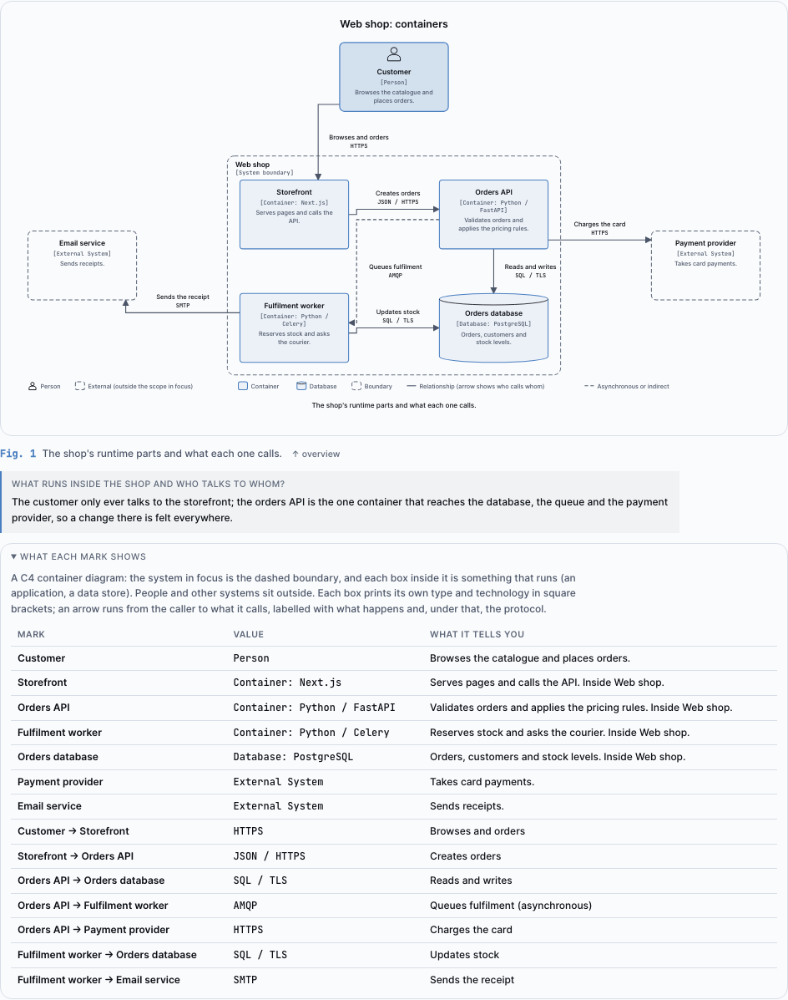
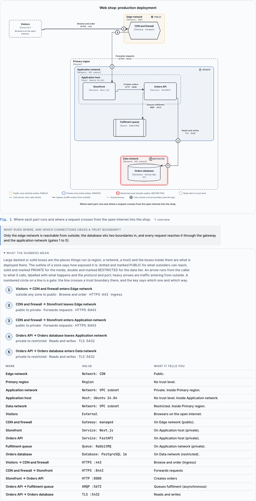
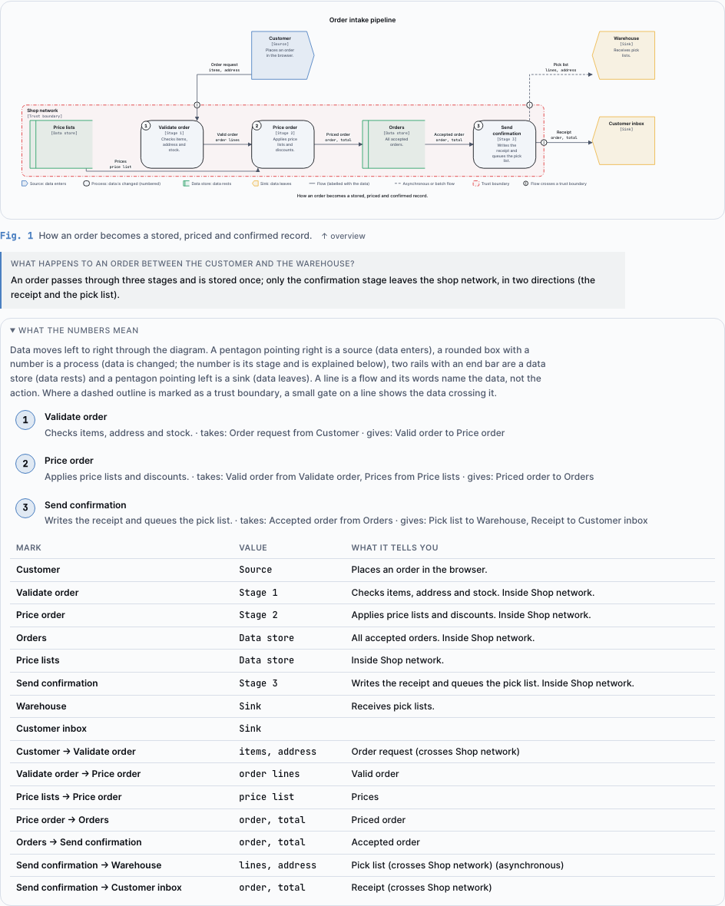
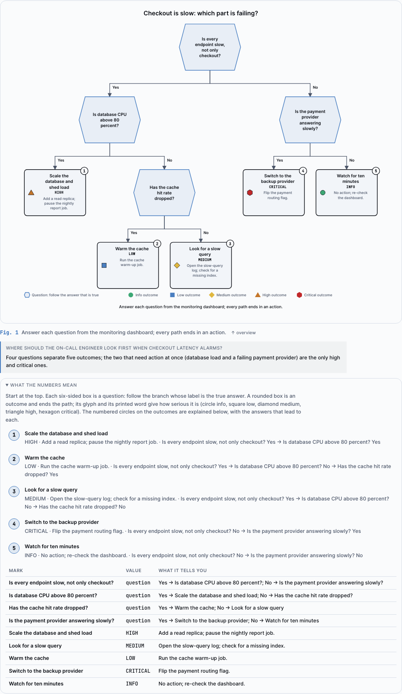
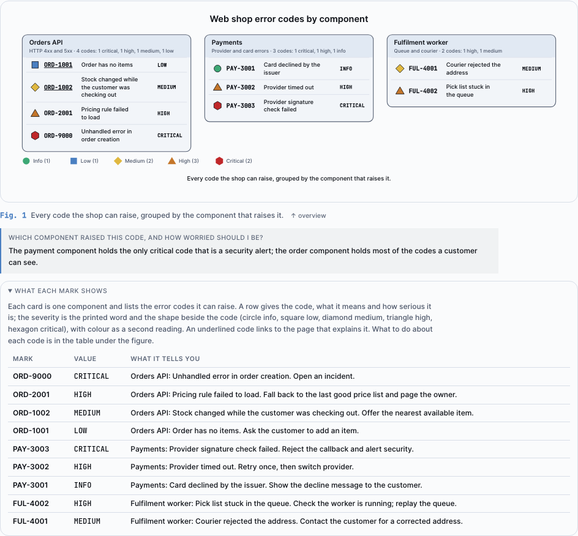
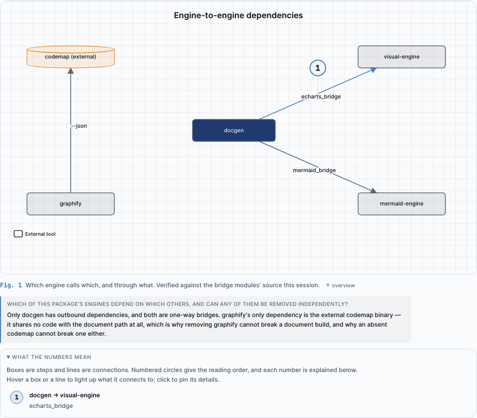
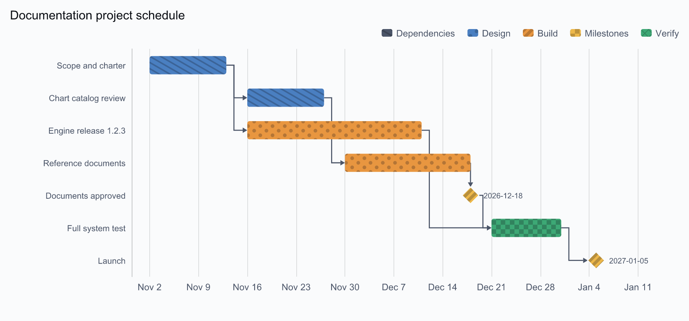
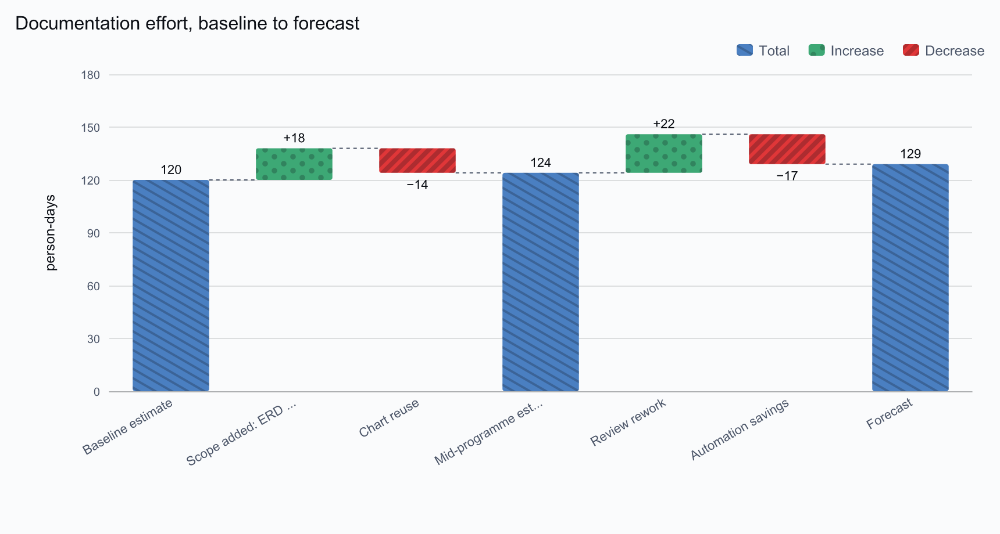
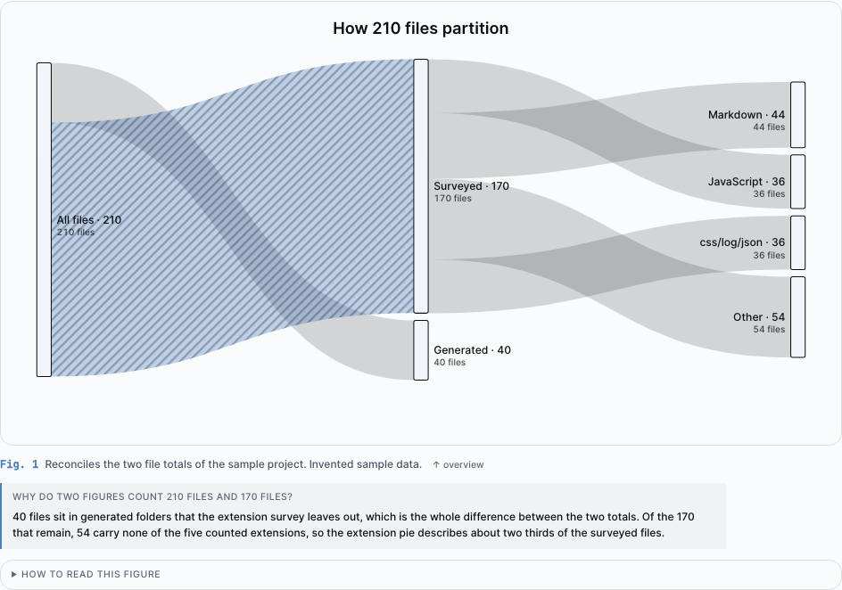

<p align="center"><b>Ultimate Engine</b></p>
<h1 align="center">Many pages in. One chart out.<br>Readable by people and by AI.</h1>

<p align="center">
  <a href="https://github.com/FreeXStudio-Platform/ultimate-engine/releases/latest"></a>
  <a href="LICENSE.md"></a>
  
  <a href="https://freexstudio.com"></a>
</p>

<p align="center">
  <a href="https://github.com/FreeXStudio-Platform/ultimate-engine/releases/latest"><b>Download</b></a> ·
  <a href="docs/INSTALL.md">Install</a> ·
  <a href="docs/CHARTS.md">All 78 charts</a> ·
  <a href="docs/HOW_IT_WORKS.md">How it works</a> ·
  <a href="CHANGELOG.md">Change log</a> ·
  <a href="SUPPORT.md">Help</a>
</p>

---

**Ultimate Engine** turns Markdown into self-contained documents whose charts, diagrams and blueprints are numbered,
sourced, explained, linked to the text, and written to a record that software can read. It works on your computer,
offline, and refuses to build a figure that would draw a confident wrong picture.

## Why one chart instead of many pages

A system described over twenty pages is hard to keep true and expensive to read, for a person and for an AI agent that
has to load every page to answer one question. A good figure holds the same structure in one view: what exists, how it
connects, and what matters. Ultimate Engine makes that view **complete and extractable**:

- each figure states the **question** it answers and the **insight** it supports;
- its marks are **numbered, explained and linked** to the text, in both directions;
- the same build writes a **record** (JSON) beside the page, so a tool reads the facts without parsing the picture.

For one error map built with version 2.0.0, the page people read is 279 KB (it carries its own fonts and styles) and the
record an AI agent reads is 5 KB, with every code, severity and suggested action:

```json
{"kind": "error_map", "groups": [{"id": "api", "label": "Orders API", "codes": [
  {"code": "ORD-1001", "name": "Order has no items", "severity": "low",
   "link": "#ord-1001", "action": "Ask the customer to add an item."}, "..."]}]}
```

How complete a record is depends on the kind of figure: **42 of the 78 catalogued kinds** write a
full per-item record today (charts in a record file beside the image, structural document figures in the blueprint). Every figure in a built document carries its question, insight, reading guide and links. The
[chart catalog](docs/CHARTS.md) says which is which; more kinds are on the way.

## A few of the charts

| | | |
|---|---|---|
|  |  |  |
|  |  |  |
|  |  |  |

**[See all 78 →](docs/CHARTS.md)**

## What you get

| Area | What is in it |
|---|---|
| **Document figures** (26) | flowchart, state, sequence, system map, dependency graph, C4, deployment, data flow, decision tree, error map, centrality, story strip, code pair, severity and incidents, maps, Sankey, isometric and more |
| **Charts** (33) | bar family, line and area, scatter and bubble, Gantt, Pareto, waterfall, fan, saturation, break-even, tornado, treemap, sunburst, heat map and more |
| **Mermaid** (6) | flowchart, sequence, class, state, entity-relationship, XY chart, rendered offline |
| **Project census** (12) | measures your own repository's documents and code and builds a report with explorers |
| **Module explorer** | a zoomable, clickable map of a hierarchy |
| **For AI agents** | one skill per figure kind, and a router from a question to the right kind |
| **Safety gates** | secret and leak checks before export, a colour-vision check, public export that strips internal markers |

## Install

1. Download `ultimate-engine-<version>.tar.gz` from the [latest release](https://github.com/FreeXStudio-Platform/ultimate-engine/releases/latest). Optionally [verify it](docs/VERIFY.md).
2. Unpack it and run the installer:

```sh
tar -xzf ultimate-engine-<version>.tar.gz
cd ultimate-engine-<version> && ./install.sh
```

3. Use it:

```sh
ultimate-engine                      # the menu
ultimate-engine init my-project
cd my-project && ultimate-engine build first-document.md -o out --formats html,blueprint
```

Requirements: macOS or Linux (Windows through WSL), Python 3.11+, OpenSSH 8.1+. Charts and Mermaid need Node.js 20+.
Full instructions: [docs/INSTALL.md](docs/INSTALL.md).

## Updates are automatic — please know this before you install

**Once a week, Ultimate Engine checks this releases page and updates itself.** This is part of the product.

- It installs a newer version only if FreeXStudio **signed** it and the download passes integrity checks.
- The previous version is kept: `ultimate-engine rollback`.
- **It never accepts new terms for you.** If a release changes the license or the privacy notice, it shows you the new texts and waits.
- It does not run on build servers that set `CI`.
- The check sends no file, account or machine identifier: [privacy notice](PRIVACY.md).

## Price and license

- **This version is free of charge.** Use it for personal or commercial work. What you create is yours.
- You may give the **complete, unchanged package** to others for free.
- You may **not** change, fork, re-host or resell the software. The code is FreeXStudio's.
- **Future versions may not be free.** FreeXStudio may introduce paid plans later. A version you already accepted does not become paid.

This summary is not the agreement. Read the [license](LICENSE.md), the [privacy notice](PRIVACY.md) and the
[third-party notices](THIRD_PARTY_NOTICES.md). The source code is not published; this repository holds the product's
documents, support and releases.

## Versions and older downloads

Every release from 2.0.0 stays on the [releases page](https://github.com/FreeXStudio-Platform/ultimate-engine/releases)
with its own download, signature and notes. See the [change log](CHANGELOG.md).

## Tell us what you need

You can't change the code, but you can change the product: tell us what to fix or add.

- **A bug:** [report it](https://github.com/FreeXStudio-Platform/ultimate-engine/issues/new?template=bug_report.yml)
- **A feature or a new chart:** [request it](https://github.com/FreeXStudio-Platform/ultimate-engine/issues/new?template=feature_request.yml)
- **A question or an idea:** [Discussions](https://github.com/FreeXStudio-Platform/ultimate-engine/discussions)
- **A security problem:** [report it privately](SECURITY.md)

What you post is public. Remove personal data, keys and private content first.

---

<p align="center">© 2026 <a href="https://freexstudio.com">FreeXStudio</a> · admin@freexstudio.com</p>
