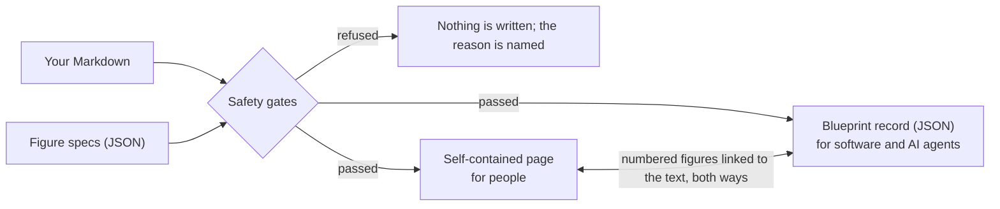
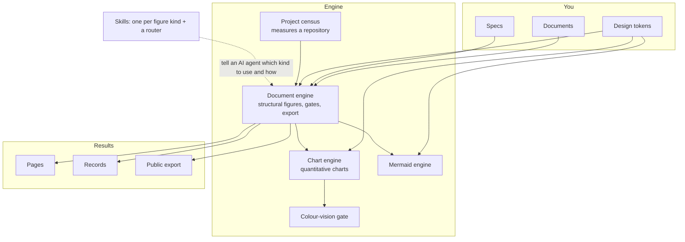

# How Ultimate Engine works

## One source, two readers

You write text, and describe each figure as data: what the parts are and how they connect. The engine draws the figure,
checks it, and writes two things that carry the same facts.

## The parts and how they connect

## What a figure carries

| In the page | In the record |
|---|---|
| a number and a caption | `number`, `caption` |
| the question it answers | `reader_question` |
| what it shows | `insight` |
| how to read it | `how_to_read` |
| numbered marks with explanations | `key` |
| where the numbers come from | `data_sources` |
| links between figure and text | `section`, `links`, `references` |
| the parts and connections drawn | `record` (kinds that write one; see the [catalog](CHARTS.md)) |

## Why a record, not a screenshot

An AI agent that is given a picture has to guess. One that is given twenty pages has to read them all and reconcile them.
A record states the parts, the connections and the values directly, with identifiers that point back into the document.
A person can check the picture; a tool can query the record; both come from one build, so they cannot drift apart.

## Refusing is a feature

The engine stops rather than draw something misleading: overlapping labels, a connection to a part that does not exist,
a truncated bar axis, a funnel that grows, categories only colour can tell apart, a number with no source. The message
names the figure, the rule and the part to fix.

## Your look

Colours and typography come from one token file you can replace. Pages load nothing from the internet.
